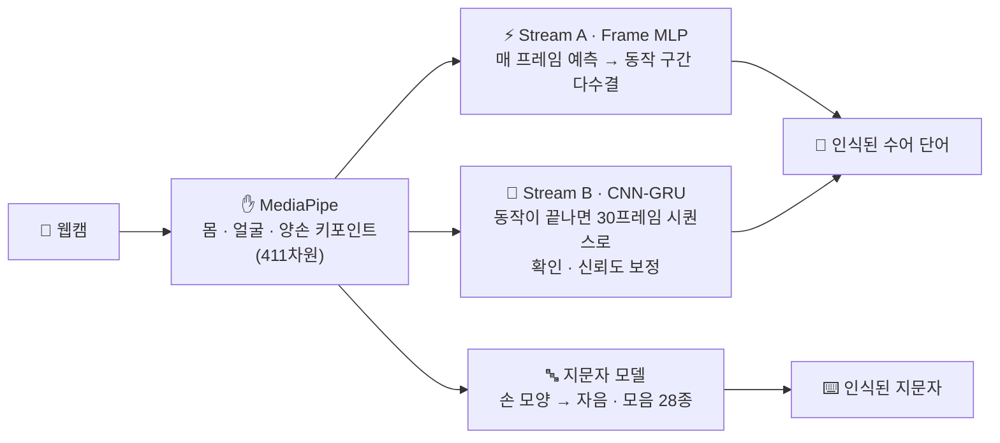

<div align="center">

### 🤟 실시간 한국 수어 번역 서비스

**수어 단어(영상)** 와 **지문자(손 모양)** 를 카메라로 실시간 인식해요

<br/>


</div>

<br/>

## 💡 어떻게 동작하나요?



- **두 갈래(Dual Stream) 인식**: 빠른 Frame MLP가 매 프레임 결과를 내고, 동작이 끝나면 CNN-GRU가 시퀀스 전체를 보고 한 번 더 확인해요. CNN-GRU 모델 파일이 없으면 MLP 단독으로도 동작해요.
- **411차원 키포인트**: 몸(25) · 얼굴(70) · 왼손(21) · 오른손(21) 랜드마크를 하나의 벡터로 써요.
- **지문자 인식**: 한글 자음 14개 · 모음 14개를 손 모양으로 인식해요.

<br/>

## 📁 프로젝트 구조

```
realtime-sign-language-translation/
├── src/
│   ├── data_prep/                      # 📦 데이터 준비
│   │   ├── video_crawling.py           #   국립국어원 한국수어사전 영상 수집
│   │   ├── video_to_keypoints.py       #   영상 → 키포인트 JSON
│   │   └── photo_to_keypoints.py       #   사진 → 키포인트 JSON
│   ├── common/
│   │   ├── mediapipe/                  # ✋ 몸 · 얼굴 · 손 키포인트 추출 래퍼
│   │   └── recognition/                # 🔤 실시간 지문자 인식
│   ├── training/                       # 🧠 학습
│   │   ├── sign_language_cnn_gru.ipynb #   단어 모델 (CNN + GRU, ELU)
│   │   ├── train_frame_mlp.py          #   단어 모델 (Frame MLP)
│   │   └── photo_model/                #   지문자 모델 (노트북 · 스크립트 · 설명서)
│   ├── inference/
│   │   └── realtime_dual_stream.py     # 🎥 실시간 단어 인식 (Dual Stream)
│   └── tools/                          # 🔧 GPU 확인 · 데이터 진단
├── models/                             # 💾 학습된 모델
│   ├── video_model/                    #   frame_mlp.pt · sign_language_cnn_gru.pt · 학습 그래프
│   └── photo_model/                    #   지문자 모델 (.pt · .pth)
└── requirements.txt
```

> 🔒 **데이터는 저장소에 포함하지 않아요.** 직접 촬영한 수어 영상·사진에는 사람의 얼굴과 몸이 담겨 있어서, `.gitignore`로 `raw/`와 `dataset/` 폴더를 제외했어요.

<br/>

## 🚀 실행 방법

**1. 설치**
```bash
pip install -r requirements.txt
```

**2. 실시간 인식** (학습된 모델이 `models/`에 들어 있어서 바로 실행돼요)
```bash
python src/inference/realtime_dual_stream.py         # 수어 단어
python src/common/recognition/realtime_recognition.py # 지문자
```
> 실행 중 `q`: 종료 · `r`: 초기화 (`r`은 단어 인식에서만)

**3. 직접 학습하려면** 데이터를 아래 위치에 두고 순서대로 실행해요.
```
raw/videos/<폴더>/      ← 원본 수어 영상          → python src/data_prep/video_to_keypoints.py
raw/photos/             ← 원본 지문자 사진        → python src/data_prep/photo_to_keypoints.py
dataset/                ← 위 단계에서 키포인트 JSON이 자동으로 생성돼요
```
```bash
python src/training/train_frame_mlp.py               # Frame MLP 학습
# CNN-GRU는 src/training/sign_language_cnn_gru.ipynb 실행
python src/training/photo_model/run_training.py      # 지문자 모델 학습
```

<br/>

## 🛠️ 개선 예정

- [ ] **검증 방식 보완**: 지금은 데이터를 6배로 증강한 **뒤에** 학습·검증·테스트로 나눠서, 같은 영상의 변형본이 학습과 테스트에 함께 들어가요. 그래서 테스트 정확도(100%)가 실제보다 높게 나왔을 가능성이 커요. **원본 영상 단위로 먼저 나누고, 학습셋에만 증강**하도록 바꿀 예정이에요.
- [ ] **라벨 정리**: `다시1`, `다시2`처럼 촬영 번호가 붙은 폴더가 서로 다른 단어로 분류돼요. 번호를 떼어 같은 단어로 묶을 예정이에요.
- [ ] 처음 보는 사람(수화자)에 대한 인식 성능 점검
- [ ] 인식 결과를 문장 · 음성으로 출력


